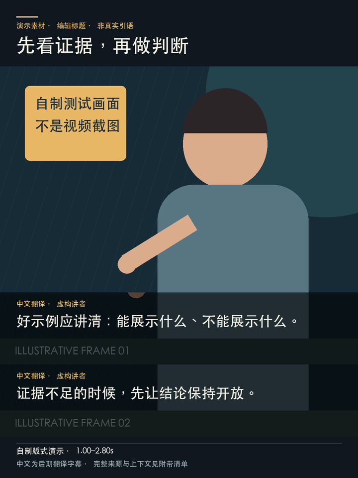

# topic-to-quote-collage

**先确认编辑角度，再让真实来源决定引语，最后做中文视频金句拼图。**

这是可独立复制的 Agent Skill。主题输入会先讨论切口；明确的视频、片段和修改 brief 可直接执行。原始多语演讲/访谈、准确原话、上下文、中文翻译与时间码一起交付，图片采用真实讲者主帧 + 字幕帧条。数量、来源网站和主题都不写死。不输出剪辑视频。



上图由自写几何图形与虚构测试文本生成，只展示布局。正式任务不得用合成画面替代真实视频帧。

## 安装与第一次使用

先解压整个 `topic-to-quote-collage` 文件夹，保留 SKILL.md 与 scripts/references/examples 的相对结构。将该文件夹复制到宿主支持的**项目级技能目录**；例如支持 `.agents/skills/` 的宿主：

```bash
mkdir -p .agents/skills
cp -R topic-to-quote-collage .agents/skills/
```

这只是用户手动安装示例。本包没有安装器，不改全局目录、系统设置或账号。不同 Agent 的发现位置以其文档为准；不识别自动发现时，直接让 Agent 阅读这个目录的 SKILL.md。`agents/openai.yaml` 仅是可选 UI 元数据，Python 脚本不依赖特定平台。

```text
使用 $topic-to-quote-collage，围绕“[主题]”做中文金句拼图。
先与我确认一个明确的编辑角度，我确认后再搜索原始视频。
```

如果已有精确 brief：

```text
使用 $topic-to-quote-collage，处理 [视频] 的 [时间段]。
角度已经确定为 [问题]，核验原话与上下文后，制作中文翻译字幕拼图并附出处。
```

更多输入包括：没选片段的视频、台词/截图追溯、仅文字稿、指定讲者、多个视频、旧图修改。每类的输入、确认点、步骤、输出、复制提示和停止条件见 [操作手册](references/operating-manual.md)。

## 依赖与能力边界

| 需要什么 | 做什么 | 是否必需 |
|---|---|---|
| Python 3.9+ | 清单校验及命令行 | 是 |
| Pillow 10.4+（<13） | 读图、排版、导出 | 渲染时 |
| 合法可用的 CJK 字体 | 中文排版 | 渲染时；不随包分发 |
| FFmpeg + ffprobe | 从本地视频提取帧并核对时长 | 视频取帧时 |
| 宿主已有的搜索/网页/视频/转录工具 | 找来源、取得媒体、听看复核与翻译 | 对应任务需要时 |

本包**没有内置搜索、视频下载、字幕解析、ASR 或翻译引擎**，不会宣称 Python 脚本能独自完成线上选题生产。不要求付费 API、账号、cookies 或指定下载平台。缺工具时说明具体缺口，不能伪造真实视频结果。

只读检查，不安装：

```bash
cd topic-to-quote-collage
python3 scripts/check_environment.py --render-only
python3 scripts/check_environment.py
```

可用 `--font`、`--ffmpeg`、`--ffprobe` 或 `QUOTE_FONT`、`QUOTE_FFMPEG`、`QUOTE_FFPROBE` 指定现有文件。Windows 使用 `py -3`，环境变量可用 PowerShell `$env:QUOTE_FONT = 'C:\path\font.ttc'`。Mac/Linux 使用 `export QUOTE_FONT='/path/to/font.ttc'`。这些均为占位示例，不带私人路径。

若用户另行决定准备 Python 环境，可在虚拟环境中安装依赖；本技能不代替用户执行此步骤：

```bash
python3 -m venv .venv
# 激活方式按本机 shell；然后：
python -m pip install -r requirements.txt
```

FFmpeg 和字体应来自用户认可的既有安装。环境检查失败时不会自动下载二进制或字体。

## 无网络复现自制示例

已有 Python、Pillow、中文字体即可，无需 FFmpeg：

```bash
python3 scripts/manifest.py examples/fixture/manifest.json --check-images
python3 scripts/render_collage.py examples/fixture/manifest.json --out output-demo --preview
python3 -m unittest discover -s tests -v
python3 scripts/audit_package.py
```

重建原始 fixture（而不是重用已附图片）：

```bash
python3 scripts/make_fixture.py --out build/fixture
python3 scripts/render_collage.py build/fixture/manifest.json --out build/demo --preview
```

运行两次同一路径会拒绝覆盖。确认替换才加 `--overwrite`，或选择新目录。需要 JPEG 时加 `--format jpg`；它和原尺寸 PNG 一样可用，`--preview` 只另附 720×960 RGB PNG。改变字体会改变像素；确定性指相同环境和输入。

## 处理真实视频

先由宿主完成来源与译文核验，按 [Manifest v1](references/manifest-schema.md) 准备本地 `job/manifest.json` 和媒体。所有路径相对该清单目录。然后：

```bash
python3 scripts/manifest.py job/manifest.json --check-videos
python3 scripts/extract_frames.py job/manifest.json
python3 scripts/render_collage.py job/manifest.json --out output-v1 --preview
```

详细说明见 [来源核验](references/source-verification.md)、[渲染指南](references/rendering.md)、[交付与 QA](references/delivery.md)。成品包括每张图片、`provenance.json` 与 `render-report.json`；宿主还须给出可读出处表，并实际打开图像完成 QA。

- 官方字幕时间和本地视频时间必须校准，两个不同锚点起步；HLS 截取起点不能想当然。
- 原生模式保留烧录字幕像素；翻译模式明显标注“中文翻译”，标题独立标明编辑性质。
- 长句、无效裁切、未审核译文与过期帧会报错，不静默截断或复用。
- 搜不到适合角度的可靠材料就回到讨论，不能硬凑引语或固定图数。

## 当前验证与发布边界

详见 [QA_REPORT.md](QA_REPORT.md)。本机验证不代表 Windows/Linux 全部实测，也不代表搜索、下载和语义核验已自动化。程序无法自动判定引语真实性、字体所有字形或人像裁切美感。

作者：**stickypoooop-AI**。本项目按 **MIT License** 公开发布；安装由使用者自行决定。上游灵感、依赖和素材范围见 [NOTICE.md](NOTICE.md)；代码许可见 [LICENSE](LICENSE)。第三方视频、讲稿、人物及字体不因代码许可取得额外授权。
